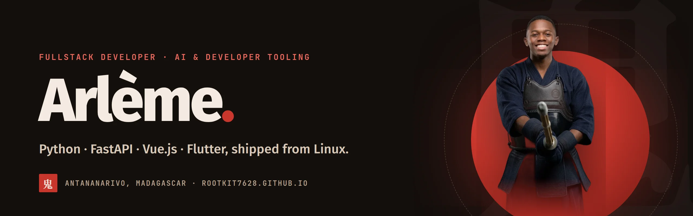

I build fullstack apps and tools that make developers faster, with AI where it actually helps.
Python and FastAPI on the back end, Vue.js or Flutter on the front, Docker and GitHub Actions to
ship, all from Linux in Antananarivo.

**Right now:** building [Nirvix](https://rootkit7628.github.io/nirvix.html), an RPG-style life app
where every finished quest levels up your character · going deeper into LLM fine-tuning ·
practising kendo.

### Selected work

| Project | What it is | Stack |
|---|---|---|
| [**Nirvix**](https://rootkit7628.github.io/nirvix.html) | Life app as a role-playing game: quests, six stats, seven ranks. Local-first, 336 tests. | Flutter · SQLite |
| [**Alandia**](https://github.com/rootkit7628/Alandia) | Madagascar's national parks: map, ratings and a forum. Hackathon 2020, rebuilt in 2026. | Expo · Flask |
| [**FaceRECON**](https://github.com/rootkit7628/FaceRECON) | Face-recognition attendance kiosk for schools. Keeps embeddings, never photos. | OpenCV · Flask |
| [**forum-orientation**](https://github.com/rootkit7628/forum-orientation) | Careers fair website: floor plan, job sheets, RIASEC orientation test. | Vue · PocketBase |
| [**Ampalibe**](https://github.com/iTeam-S/Ampalibe) | Python framework for Messenger chatbots, built with the iTeam-S community. | Python |

### Open source

- [**wttr.in**](https://github.com/chubin/wttr.in): Malagasy translation of the weather service ([#654](https://github.com/chubin/wttr.in/pull/654), [#669](https://github.com/chubin/wttr.in/pull/669))
- [**WebSearch**](https://github.com/iTeam-S/WebSearch): KML file search and a web-server version ([#11](https://github.com/iTeam-S/WebSearch/pull/11), [#14](https://github.com/iTeam-S/WebSearch/pull/14))
- [**validator.js**](https://github.com/validatorjs/validator.js): Malagasy mobile numbers ([#1774](https://github.com/validatorjs/validator.js/pull/1774))
- [**Mvola**](https://github.com/rivo2302/Mvola): continuous integration for the MVola payment SDK ([#6](https://github.com/rivo2302/Mvola/pull/6))

### Stack

### Recognition

Hackathons: **1st** at ZahaGeek 2023 · **3rd** at Google DevFest 2021 · **1st** at MYBN 2021.

Communities: iTeam-S (head), GDG Antananarivo, GDSC ESTI, Why Not Linux Madagascar, DjangoGirls,
Makoto Japanese Club.

### Find me

[Portfolio](https://rootkit7628.github.io) ·
[LinkedIn](https://www.linkedin.com/in/arleme-jhn/) ·
[X](https://x.com/_bmainty) ·
[Stack Overflow](https://stackoverflow.com/users/14732398/arleme) ·
[daily.dev](https://app.daily.dev/bmainty) ·
[arleme.dev7@gmail.com](mailto:arleme.dev7@gmail.com)

